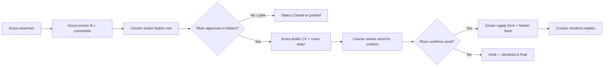

# Job-seeking pipeline (Scout + Courier)

A two-bot Grok Bot workflow for River’s personal job search. DimSum (Chief of Staff) coordinates; River approves every shortlist and every outbound send.

Recorded: **2026-10-27** (Asia/Hong_Kong).

## Why two bots

| Bot | Lane | Does | Does not |
|-----|------|------|----------|
| **Scout · Job Fit & CV** | Reasoning + writing | Search suitable roles; score fit and adaptability; write Notion comments; draft tailored CV + cover letter after approval | Send email, submit applications, or contact recruiters |
| **Courier · Job Outreach & Submissions** | Ops | Record roles in Notion; watch approvals; send applications via connected Gmail (or forms) only after River’s explicit OK; monitor replies and update status | Invent fit scores or rewrite CV facts |

Split keeps “is this role right / how do I present myself?” separate from “log it, ship it, track it.”

## End-to-end workflow

### 1. Outreach (discover + record)

1. Scout searches (LinkedIn jobs, company careers, web) using River’s targets: titles, location/remote, seniority, salary floor, dealbreakers.
2. For each shortlist item, Scout reasons: fit score, why it fits, gaps, risks (ghost/repost, placeholder salary, visa/on-site).
3. Courier creates or updates a Notion pipeline row with title, company, location/remote, posted date, salary if shown, apply route, URL, fit score, Scout’s comments, and status **New**.

There is no dedicated LinkedIn/Indeed job connector today — Scout uses the browser (and optionally a weekday morning search routine once targets are locked).

### 2. Writing (after Notion approval)

1. River sets the row to **Approved** (or equivalent) in Notion.
2. Courier notices and asks Scout to draft.
3. Scout drafts a tailored CV and cover letter from River’s **real** facts only — never invents qualifications — and attaches them to the Notion row (status → **Drafting** / **Ready to send**).

### 3. Submissions + monitoring

1. Courier prepares the outbound (Gmail message or apply-form payload): recipient, subject, body, attachments.
2. **Hard gate:** nothing leaves until River confirms that specific send. Declined = final.
3. On send, Courier records **Sent** (and what went out) in Notion.
4. Courier watches Gmail for employer/recruiter replies, updates Notion (**Replied** / **Interview** / **Rejected** / **Closed**), summarizes to River, and offers reply drafts — never auto-replies.

## Suggested Notion status ladder

`New` → `Approved` → `Drafting` → `Ready to send` → `Sent` → `Replied` → `Interview` → `Rejected` / `Closed`

Courier owns the board schema and row hygiene; DimSum only escalates when River is the bottleneck (missing targets, CV source, or a stuck approval).

## Inputs still required before Scout runs cold

- CV / LinkedIn (or other resume facts) in Scout’s memory
- Target titles, Hong Kong vs remote, seniority, salary floor, dealbreakers
- Notion board URL (create or point Courier at an existing DB)
- Optional: weekday morning search routine (DimSum creates once targets exist)

## Safety / stewardship notes

- Human-in-the-loop on **approve role** and **confirm send** — same spirit as brand “safe outbound.”
- Demographic, salary-history, and work-authorization answers only from River.
- DimSum does not do Scout/Courier’s lane work; coordinates and updates this wiki when the pattern changes.

## Connections

- **Serves:** action-oriented individual (River) landing a career move with agent leverage — pattern also teaches SMBs/solo operators how to split reasoning vs ops bots.
- **Fills gaps:** multi-bot design; Notion as approval queue; Gmail submission with explicit send confirm; reply monitoring without auto-reply.
- **Supports big idea:** idea (run a job search with agents) → enough knowledge (this playbook) → action (Scout + Courier + Notion + Gmail).
- **Upstream:** [[brand-thesis]] · [[kb-process]] · [[../articles/grok-bot-guide]] (multi-bot + safe outbound).
- **Related agents:** Scout · Job Fit & CV · Courier · Job Outreach & Submissions · DimSum (coordinator).
